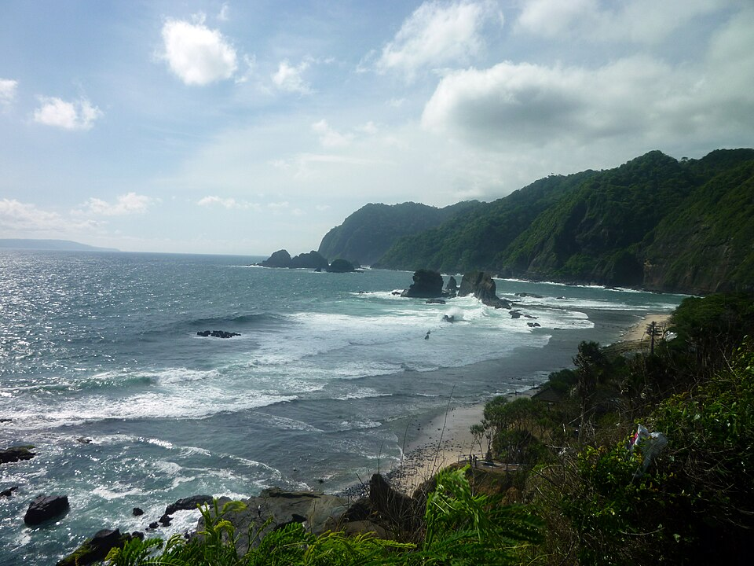
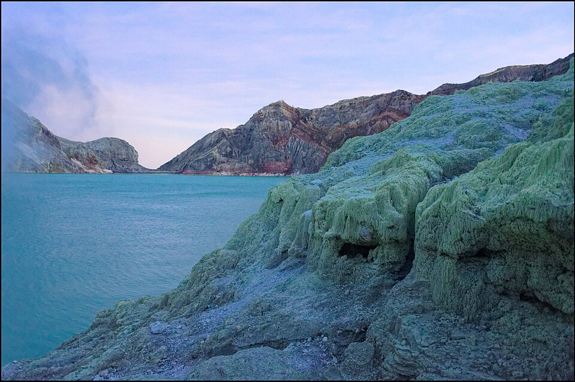

# Jelajah Jatim

Aplikasi Android berbasis Jetpack Compose untuk eksplorasi destinasi wisata, paket tur, dan informasi kondisi alam di wilayah Jawa Timur (Jember, Banyuwangi, Bromo, Malang).

---

## Galeri Destinasi

| Tanjung Papuma | Bromo Sunrise | Kawah Ijen |
| :---: | :---: | :---: |
|  |  |  |

---

## Fitur Utama

- Eksplorasi destinasi dan paket tur berdasarkan kategori wilayah.
- Monitoring kondisi alam (status pasang laut, ombak, dan aksesibilitas jalan).
- Mode luring (Offline Vault) menggunakan Room Database.
- Integrasi Google Gemini API untuk rekomendasi tur.
- Penerapan token warna semantik, tabular-nums untuk angka/harga, dan standar touch target seluler.

---

## Cara Menjalankan Project

### Prasyarat
- Android Studio Ladybug atau versi lebih baru
- JDK 11
- Android SDK 36

### Langkah Instalasi

1. Clone repository:
   ```bash
   git clone https://github.com/rafifandriyanto/jelajah-jatim.git
   cd jelajah-jatim
   ```

2. Buat file `.env` di direktori utama dan isi dengan Gemini API key:
   ```env
   GEMINI_API_KEY=API_KEY_ANDA
   ```

3. Buka project di Android Studio, jalankan Gradle Sync, lalu jalankan aplikasi pada emulator atau perangkat fisik.

---

## Teknologi

- UI: Jetpack Compose (Material 3)
- Bahasa: Kotlin
- Database Lokal: Room Database & Flow
- Image Loading: Coil
- Konfigurasi Secret: Secrets Gradle Plugin
- AI: Google Gemini API
